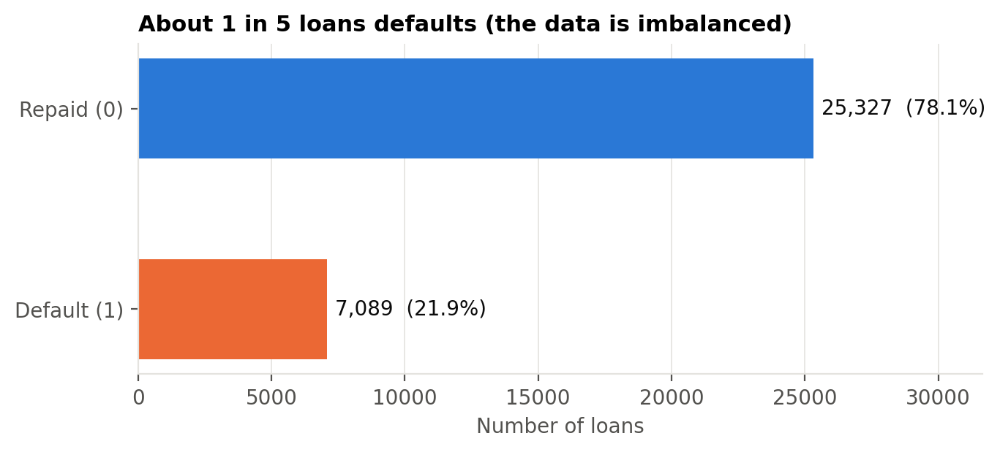
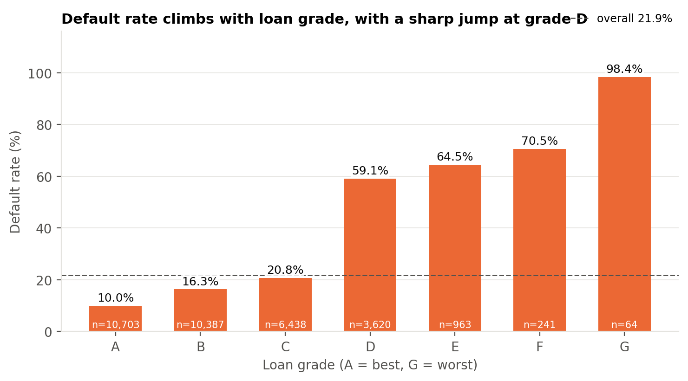
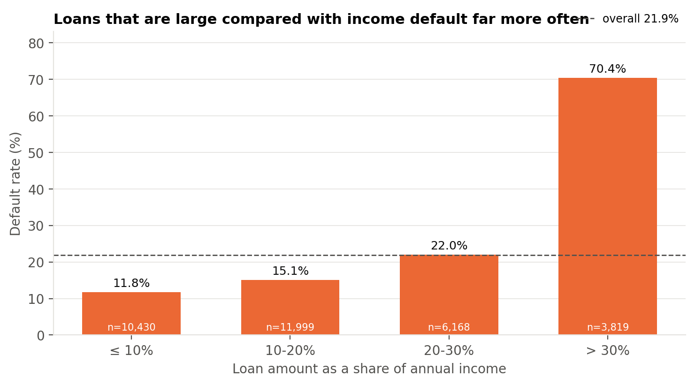
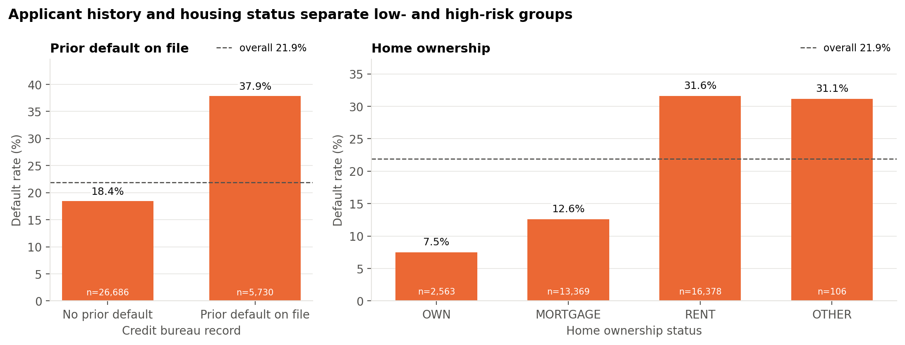
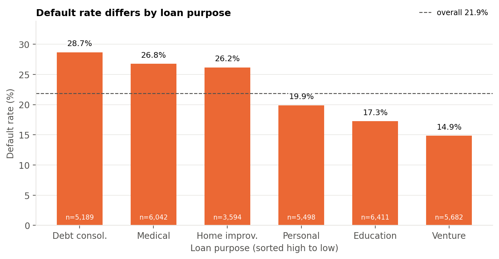
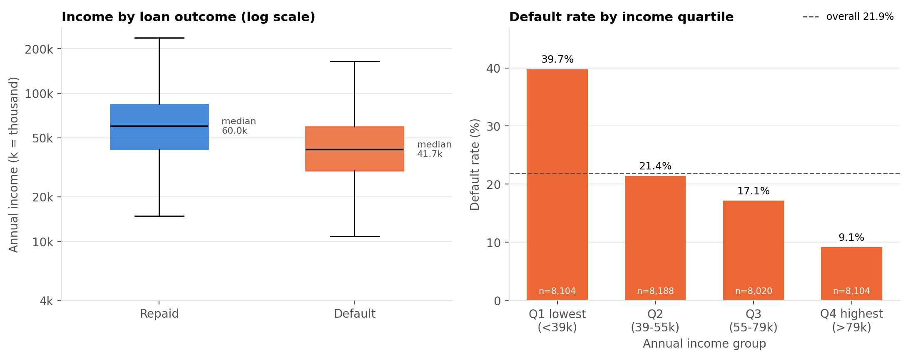
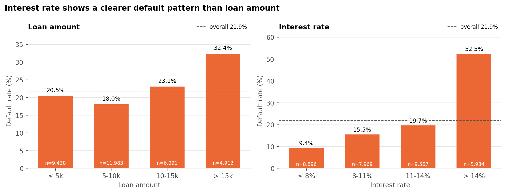
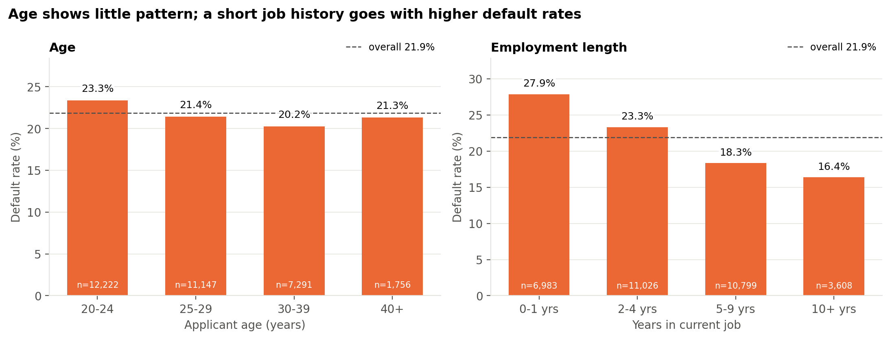
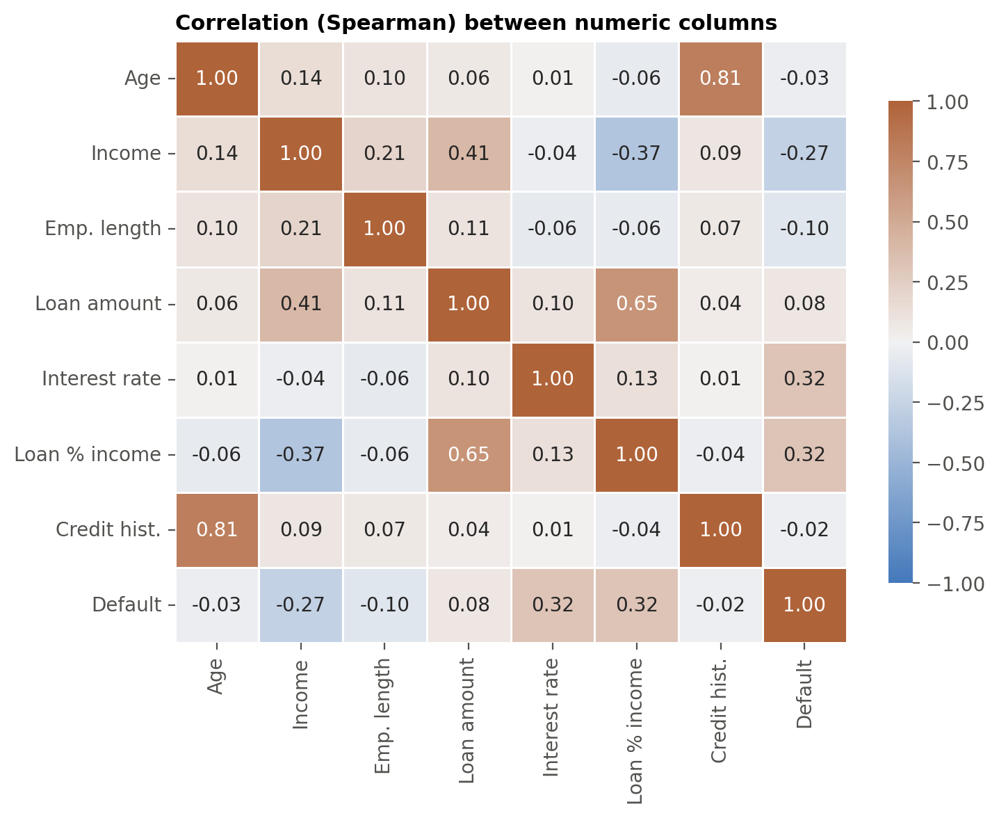

# EDA Observations and Figure Captions

**Member 2: Analysis & Visualization**  |  Project: Credit Risk Scoring and Loan Default Analysis

Dataset: `final_validated_dataset.csv` (32,416 loans). Default = `loan_status` of 1. Overall default rate: **21.9%**.

## Key observations

### Loan status

*Figure 1. Number and share of repaid and defaulted loans (n = 32,416).*

**Observation:** 7,089 of 32,416 loans (21.9%) defaulted, about 1 default for every 3.6 repaid loans. The target is imbalanced, so accuracy alone would be a misleading score for the model; recall, precision and ROC-AUC should also be reported.

### Loan grade

*Figure 2. Default rate for each loan grade (A = best, G = worst). The dashed line is the overall default rate (21.9%); n is the number of loans in the group.*

**Observation:** Default rate rises from 10.0% (grade A) to 20.8% (grade C), then jumps to 59.1% at grade D and reaches 98.4% at grade G. Grades D-G hold 15.1% of loans (4,888) but default at 61.2%. Grade G has only 64 loans, so its rate is less reliable. Grade is assigned by the lender, so this pattern partly reflects the lender's own risk assessment.

### Loan size compared with income

*Figure 3. Default rate across loan-to-income ratio categories, showing how default frequency changes as the loan amount increases relative to annual income.*

**Observation:** Default rate is 11.8% when the loan is 10% or less of income and 70.4% when it is above 30%. The 3,819 loans above 30% (11.8% of all loans) account for 37.9% of all defaults. This is one of the strongest patterns in the data.

### Prior default and home ownership

*Figure 4. Default rate by prior default record (left) and home ownership (right).*

**Observation:** Applicants with a prior default on file default at 37.9% versus 18.4% for those without (about double). Renters default at 31.6% versus 12.6% for mortgage holders and 7.5% for owners; renters are 50.5% of loans but 73.0% of defaults. The OTHER group (n = 106) is too small for firm conclusions.

### Loan purpose

*Figure 5. Default rate by loan purpose, sorted from highest to lowest.*

**Observation:** Debt consolidation (28.7%), medical (26.8%) and home improvement (26.2%) loans default above the overall rate; venture (14.9%) and education (17.3%) loans default below it. The gap between purposes is up to 13.8 percentage points, smaller than the gaps for grade or loan burden.

### Applicant income

*Figure 6. Left: annual income of repaid and defaulted loans (log scale, extreme values hidden). Right: default rate by income quartile (k = thousand; currency not stated in the dataset).*

**Observation:** Median income is 41.7k for defaulted loans versus 60.0k for repaid loans. The lowest-income quartile (below 39k) defaults at 39.7%, the highest (above 79k) at 9.1%. Income is very skewed (maximum 6,000,000), so medians and quartiles are used instead of averages.

### Loan amount and interest rate

*Figure 7. Default rates across loan amount categories (left) and interest rate categories (right), highlighting the relationship between borrowing characteristics and loan default.*

**Observation:** Loans above 15k default at 32.4% versus 18.0% for 5k-10k, but the pattern is not smooth (20.5% for loans up to 5k). Interest rate shows a clearer pattern: 9.4% at 8% or less and 52.5% above 14%. Median interest rate is 13.48% for defaulted loans versus 10.65% for repaid loans. Like grade, the interest rate is set by the lender after assessing risk.

### Age and employment length

*Figure 8. Default rate by age group (left) and years in current job (right).*

**Observation:** Age shows almost no pattern (20.2% to 23.3% across groups). Default rate falls as employment length increases: 27.9% for 0-1 years versus 16.4% for 10+ years.

### Correlation heatmap

*Figure 9. Spearman correlation between numeric columns (orange = positive, blue = negative).*

**Observation:** The columns most associated with default are interest rate (0.32), loan share of income (0.32) and income (-0.27). Employment length (-0.10), loan amount (0.08), age (-0.03) and credit history length (-0.02) are weak. Age and credit history length are strongly correlated with each other (0.81), and loan amount with loan share of income (0.65), so some columns carry overlapping information. Correlation does not show that one factor causes default.

## Limitations (read before using these findings)

- Each chart compares one attribute at a time, but attributes overlap. Example: 21% of loans above 30% loan burden are grade D-G, versus 14% of other loans. Within grades D-G, a prior default adds almost nothing (60.8% without, 61.6% with).
- Two factors together can separate risk more than one alone. Example: low income (bottom quartile) with loan burden above 30% defaults at 77.8%; low income with burden of 30% or less at 27.8%; neither at 12.0%. The modelling team should test combinations, not single columns.
- These are patterns in historical data. They show association, not cause: for example, the data cannot show that renting causes default.
- Grade and interest rate are set by the lender, so their link with default partly shows the lender's own risk assessment.

## Data notes

- Assumption to confirm with Member 1: loan_status = 1 means default and 0 means repaid. The currency of income and loan amount is not stated, so figures show plain numbers.
- The file has 32,416 rows and 12 columns, with no missing values and no duplicate rows.
- A few extreme values remain: 2 applicants older than 80 (maximum 94), 1 applicant with 41 years of employment, and 9 incomes above 1,000,000 (maximum 6,000,000). They were kept; charts use log scale, medians and quartiles so they do not distort the results. Whether to remove them is a decision for the team.
