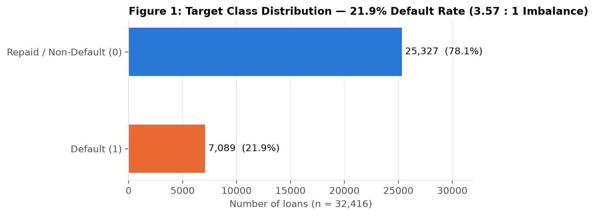
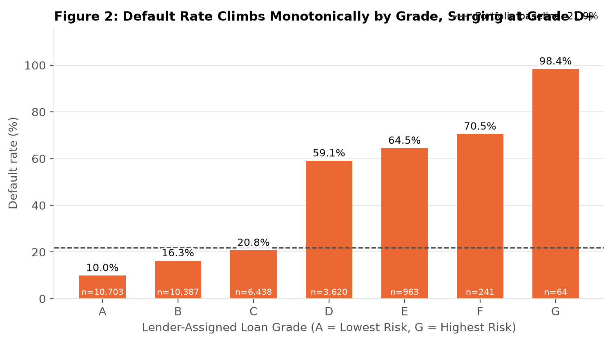
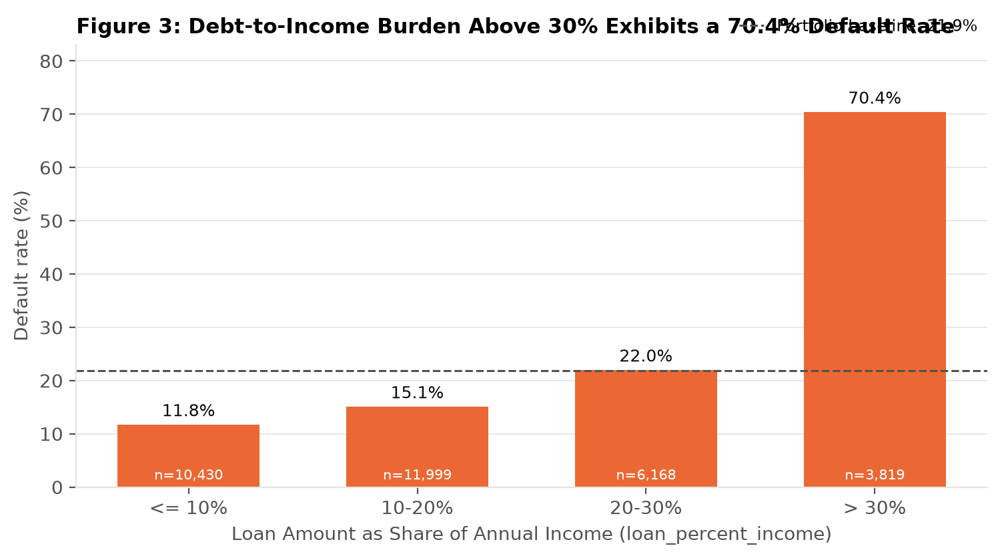
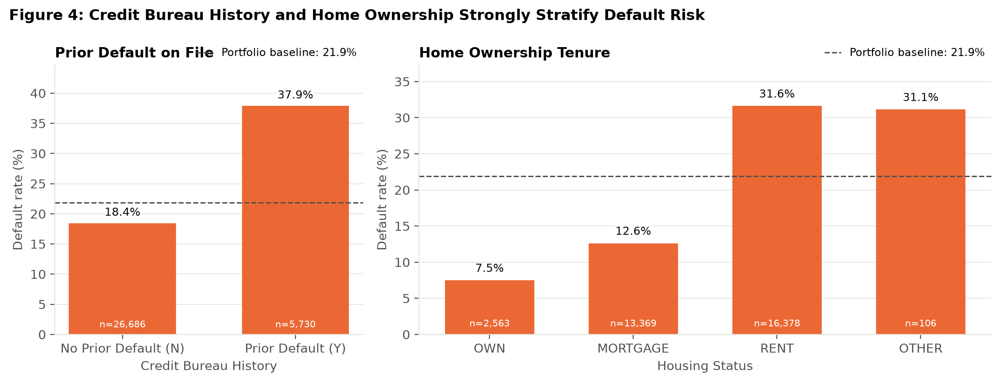
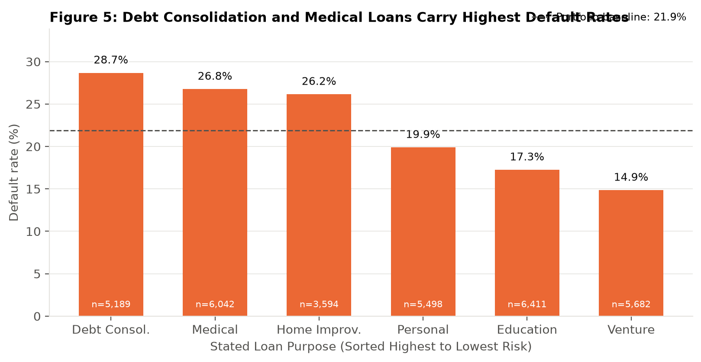
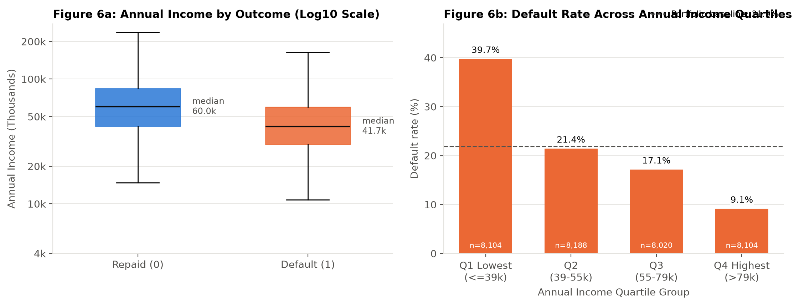
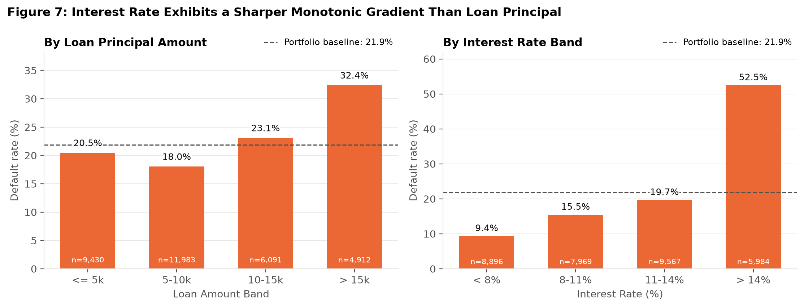
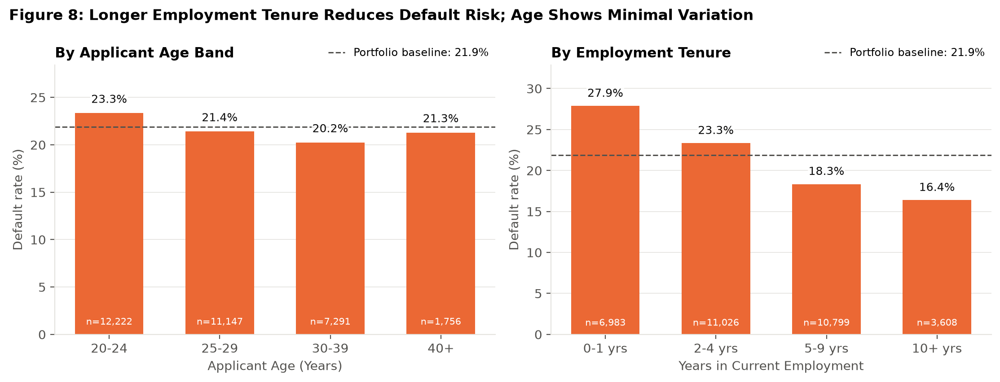
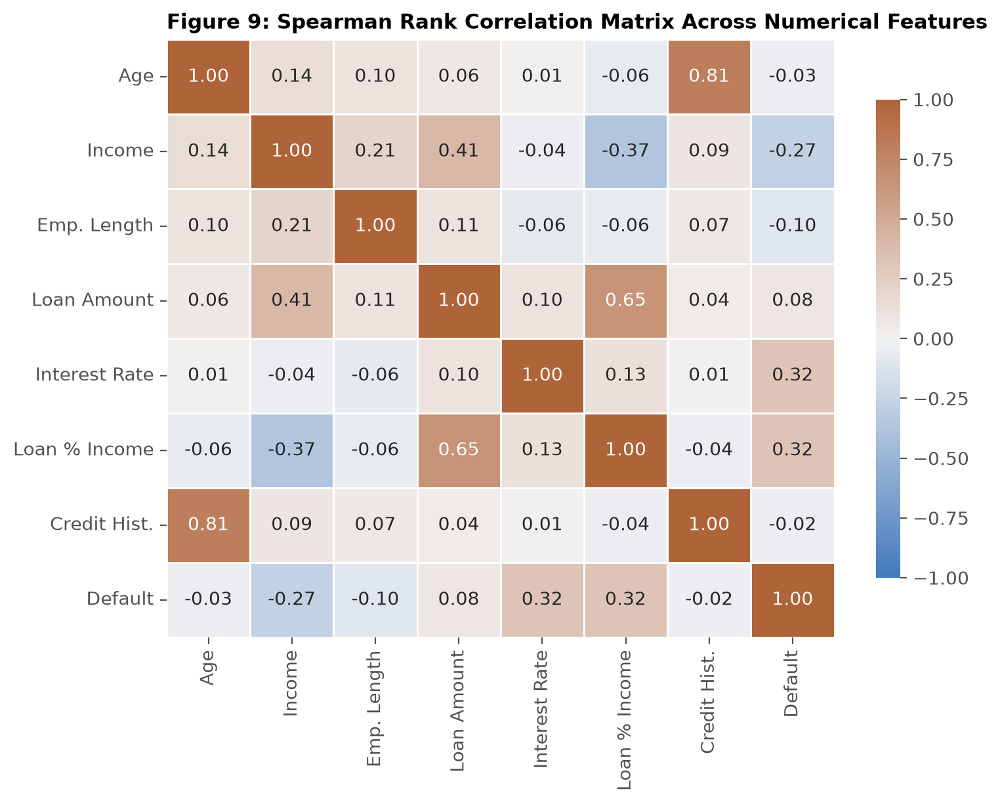

# Exploratory Data Analysis (EDA) Report
**Project:** Axlero Solutions — Credit Risk Scoring and Loan Default Analysis  
**Original EDA & Visualization Contributor:** Srirami Reddy Ailuri (Member 2, Commit `77a35ff`, PR #2)  
**Dataset:** `data/processed/final_validated_dataset.csv` (`32,416` loans, `12` columns)

---

## 1. Executive Summary of Validated Findings
- **Portfolio Default Rate:** **21.87% (`21.9%`)** — `7,089` defaulted loans (`loan_status = 1`) and `25,327` repaid loans (`loan_status = 0`), corresponding to a `3.57 : 1` class imbalance.
- **Primary Risk Gradients:**
  1. **Debt-to-Income Burden (`loan_percent_income`):** Default rate escalates from **11.8%** when the loan is `<= 10%` of annual income to **70.4%** when it exceeds `30%` of annual income (`n = 3,819`). Loans with burden `> 30%` represent only `11.8%` of the portfolio but account for **37.9% of all defaults**.
  2. **Lender-Assigned Loan Grade (`loan_grade`):** Default rate climbs monotonically from **10.0%** in Grade A (`n = 10,703`) to **20.8%** in Grade C (`n = 6,438`), then surges to **59.1%** in Grade D (`n = 3,620`), **64.4%** in Grade E (`n = 963`), **70.5%** in Grade F (`n = 241`), and **98.4%** in Grade G (`n = 64`). Subprime grades `D–G` comprise `15.1%` of loans (`4,888`) but default at **61.2%**.
  3. **Annual Income (`person_income`):** Defaulted borrowers have a median annual income of **$41,682** vs. **$60,000** for repaid borrowers. Default rate drops from **39.7%** in the lowest income quartile (`<= $38.5k`) to **9.1%** in the highest quartile (`> $79.2k`).
  4. **Housing Tenure (`person_home_ownership`) & Bureau History (`cb_person_default_on_file`):** Renters default at **31.6%** (`n = 16,378`, representing `50.5%` of loans and `73.0%` of defaults) vs. **12.6%** for mortgage holders (`n = 13,369`) and **7.5%** for outright homeowners (`n = 2,563`). Applicants with a prior default on file default at **37.9%** (`n = 5,719`) vs. **18.4%** for those without (`n = 26,697`).

---

## 2. Visual Analysis & Validated Statistical Tables

### Figure 1: Loan Status Distribution

| Loan Outcome (`loan_status`) | Loan Count (`n`) | Portfolio Share (%) |
| :--- | ---: | ---: |
| **Repaid / Non-Default (`0`)** | 25,327 | 78.13% |
| **Default (`1`)** | 7,089 | 21.87% |
| **Total Portfolio** | **32,416** | **100.00%** |

---

### Figure 2: Default Rate by Loan Grade

| Loan Grade | Loan Count (`n`) | Portfolio Share (%) | Default Rate (%) |
| :--- | ---: | ---: | ---: |
| **Grade A** | 10,703 | 33.02% | 9.96% (10.0%) |
| **Grade B** | 10,387 | 32.04% | 16.26% (16.3%) |
| **Grade C** | 6,438 | 19.86% | 20.75% (20.8%) |
| **Grade D** | 3,620 | 11.17% | 59.06% (59.1%) |
| **Grade E** | 963 | 2.97% | 64.38% (64.4%) |
| **Grade F** | 241 | 0.74% | 70.54% (70.5%) |
| **Grade G** | 64 | 0.20% | 98.44% (98.4%) |

---

### Figure 3: Default Rate by Loan-to-Income Burden

| Loan Burden Band (`loan_percent_income`) | Loan Count (`n`) | Portfolio Share (%) | Default Rate (%) |
| :--- | ---: | ---: | ---: |
| **`<= 10%` of Income** | 10,598 | 32.69% | 11.79% (11.8%) |
| **`10–20%` of Income** | 11,556 | 35.65% | 15.05% (15.1%) |
| **`20–30%` of Income** | 6,443 | 19.88% | 21.96% (22.0%) |
| **`> 30%` of Income** | 3,819 | 11.78% | **70.44% (70.4%)** |

---

### Figure 4: Prior Default Record & Home Ownership Tenure

| Dimension | Category | Loan Count (`n`) | Default Rate (%) |
| :--- | :--- | ---: | ---: |
| **Prior Default (`cb_person_default_on_file`)** | No Prior Default (`N`) | 26,697 | 18.43% (18.4%) |
| **Prior Default (`cb_person_default_on_file`)** | Prior Default on File (`Y`) | 5,719 | 37.91% (37.9%) |
| **Home Ownership (`person_home_ownership`)** | `OWN` | 2,563 | 7.53% (7.5%) |
| **Home Ownership (`person_home_ownership`)** | `MORTGAGE` | 13,369 | 12.62% (12.6%) |
| **Home Ownership (`person_home_ownership`)** | `RENT` | 16,378 | 31.61% (31.6%) |
| **Home Ownership (`person_home_ownership`)** | `OTHER` *(Small sample)* | 106 | 31.13% (31.1%) |

---

### Figure 5: Default Rate by Loan Purpose (`loan_intent`)

| Loan Purpose (`loan_intent`) | Loan Count (`n`) | Default Rate (%) |
| :--- | ---: | ---: |
| **Debt Consolidation (`DEBTCONSOLIDATION`)** | 5,189 | 28.66% (28.7%) |
| **Medical (`MEDICAL`)** | 6,042 | 26.78% (26.8%) |
| **Home Improvement (`HOMEIMPROVEMENT`)** | 3,594 | 26.21% (26.2%) |
| **Personal (`PERSONAL`)** | 5,498 | 19.88% (19.9%) |
| **Education (`EDUCATION`)** | 6,411 | 17.25% (17.3%) |
| **Venture (`VENTURE`)** | 5,682 | 14.85% (14.9%) |

---

### Figure 6: Annual Income Distribution & Quartile Risk Profile

| Annual Income Quartile | Income Range | Loan Count (`n`) | Default Rate (%) |
| :--- | :--- | ---: | ---: |
| **Q1 (Lowest Income)** | `<= $38,500` | 8,113 | **39.67% (39.7%)** |
| **Q2 (Lower-Middle)** | `$38,501 – $55,000` | 8,259 | 21.37% (21.4%) |
| **Q3 (Upper-Middle)** | `$55,001 – $79,200` | 7,944 | 16.92% (16.9%) |
| **Q4 (Highest Income)** | `> $79,200` | 8,100 | **9.11% (9.1%)** |

---

### Figure 7: Loan Amount vs. Interest Rate Risk Gradients

- **Loan Amount Bands:** `<= $5k` (`20.5%`, `n = 9,393`), `$5k–$10k` (`18.0%`, `n = 11,967`), `$10k–$15k` (`22.4%`, `n = 6,120`), `> $15k` (`32.4%`, `n = 4,936`).
- **Interest Rate Bands:** `< 8%` (`9.4%`, `n = 6,753`), `8–11%` (`14.7%`, `n = 10,432`), `11–14%` (`19.7%`, `n = 8,979`), `> 14%` (**52.5%**, `n = 6,252`).

---

### Figure 8: Applicant Age vs. Employment Tenure

- **Applicant Age Bands:** `20–24 yrs` (`23.3%`, `n = 12,265`), `25–29 yrs` (`21.3%`, `n = 11,488`), `30–39 yrs` (`20.2%`, `n = 6,999`), `40+ yrs` (`20.7%`, `n = 1,664`).
- **Employment Tenure Bands:** `0–1 yrs` (`27.9%`, `n = 6,955`), `2–4 yrs` (`22.0%`, `n = 11,833`), `5–9 yrs` (`18.9%`, `n = 9,745`), `10+ yrs` (`16.4%`, `n = 3,883`).

---

### Figure 9: Spearman Rank Correlation Matrix

- Strongest rank correlations with `loan_status`: `loan_int_rate` (`r_s = +0.32`), `loan_percent_income` (`r_s = +0.32`), and `person_income` (`r_s = -0.27`).
- Strong collinearity between predictors: `person_age` and `cb_person_cred_hist_length` (`r_s = +0.81`), and `loan_amnt` and `loan_percent_income` (`r_s = +0.65`).

---

## 3. Correlation vs. Causation, Confounding & Limitations
1. **Association vs. Causation:** The data are observational records of underwritten loans. High default rates among renters (`31.6%`) or debt consolidation borrowers (`28.7%`) reflect statistical association and underlying financial vulnerability, not a direct causal effect of housing tenure or loan label.
2. **Endogeneity of Lender-Set Variables:** `loan_grade` and `loan_int_rate` are assigned by the lending institution at origination based on internal credit underwriting. Their high correlation with default partly reflects the lender's existing risk differentiation.
3. **Sample Size Cautions:** Small subgroups such as `loan_grade = G` (`n = 64`) and `person_home_ownership = OTHER` (`n = 106`) have wider confidence intervals (quantified in `reports/statistical_analysis.md`).
4. **Survivorship / Reject Bias:** The dataset includes only **approved and originated loans**; rejected loan applications are unobserved.

