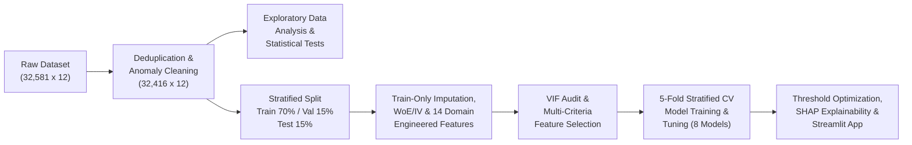

# Final Project Report — Credit Risk Scoring & Loan Default Analysis
**Organization:** Axlero Solutions — Data Analytics & Machine Learning Division  
**Domain:** Finance & Banking  
**Repository:** `https://github.com/pujansonani/axlero-data-analytics`  
**Team Lead:** Pujan Sonani  
**Team Members:** Darshan Patil, Srirami Reddy Ailuri, Charukesh, Pavani, Sowmya

---

## 1. Executive Summary
This project delivers an end-to-end, reproducible **Credit Risk Scoring and Loan Default Analysis** platform built on `32,581` consumer loan records (`32,416` validated loans after exact deduplication). By combining rigorous data governance, statistical hypothesis testing, Weight of Evidence (WoE) & Information Value (IV) scorecard analytics, leakage-free domain feature engineering, cross-validated machine learning, asymmetric cost-threshold optimization, SHAP explainability, and an interactive 8-page Streamlit application, the platform achieves a **held-out Test ROC-AUC of 0.9553** (`PR-AUC = 0.9199`, `KS = 0.7891`, `Brier = 0.0466`).

---

## 2. End-to-End Architecture & Workflow Summary

---

## 3. Key Analytical & Modeling Milestones

### 3.1 Data Quality & Preprocessing (Module 1)
- Removed `165` redundant exact duplicate rows (`keep='first'`), clarifying why `duplicated(keep=False)` reported `330` total rows in duplicate pairs.
- Remediated `5` impossible age records (`> 100` yrs: `123` and `144`) and `2` impossible employment length records (`123` yrs).
- Benchmarked **Global Median**, **Loan-Grade Stratified Median**, and **Multivariate KNN Imputation (`k=5`)** on `1,500` masked validation records: Loan-Grade Median reduced interest rate RMSE by **69.1%** (`1.0184%` vs `3.2917%`).
- Resolved the **1,005 `loan_percent_income` consistency mismatches** into two exact root causes: **618** decimal rounding boundary cases (`|diff| <= 0.01`) and **387** records where `person_income = 0.85 × gross_income` (`15%` net-vs-gross income deduction).

### 3.2 Exploratory Data Analysis & Statistical Testing (Modules 2 & 3)
- Validated the **21.87%** overall default rate (`7,089` defaults vs `25,327` repaid loans).
- Confirmed via non-parametric Mann-Whitney U, Kolmogorov-Smirnov (KS), and Chi-Square / Cramér's V tests that the strongest standalone risk drivers are `loan_percent_income` ($D_{KS} = 0.3519$, $\text{IV} = 0.8761$), `loan_grade` ($V = 0.4152$, $\text{IV} = 0.8583$), `loan_int_rate` ($D_{KS} = 0.3340$, $\text{IV} = 0.7038$), `person_income` ($D_{KS} = 0.2802$, $\text{IV} = 0.4557$), and `person_home_ownership` ($V = 0.2417$, $\text{IV} = 0.3801$).
- Demonstrated multi-factor compounding risk: applicants in the lowest income quartile (`<= $38.5k`) with loan burden `> 30%` default at **77.8%**, compared to **12.0%** when neither risk factor is present.

### 3.3 Feature Engineering & Machine Learning Evaluation (Modules 4 & 5)
- Engineered `14` domain features (fitted strictly on `df_train`), filtered exact collinear duplicates via VIF, and trained `8` models.
- **Champion Model (`Gradient Boosting (Tuned)`):**
  - **5-Fold CV ROC-AUC:** `0.9442 ± 0.0061`
  - **Validation ROC-AUC:** `0.9469` (`PR-AUC = 0.9073`)
  - **Held-Out Test ROC-AUC:** **`0.9553`** (`PR-AUC = 0.9199`, `KS = 0.7891`, `Brier = 0.0466`)
  - **F1-Optimal Threshold (`0.39`):** `94.41%` Accuracy, `95.00%` Precision, `78.57%` Recall, `0.8601` F1-Score.
  - **5:1 Cost-Optimal Threshold (`0.16`):** `86.56%` Recall (`921 / 1,064` defaults caught), reducing missed defaults by **43.5%**.

---

## 4. Business Recommendations for Credit Underwriting
1. **Automated Three-Tier Risk Routing:**
   - **Tier 1 — Low Risk (`PD < 20%`):** Auto-approve at standard grade pricing (`~72%` of applicants, observed default rate `< 3.5%`).
   - **Tier 2 — Medium Risk (`20% <= PD < 50%`):** Route to manual underwriting review or require debt-to-income cap reduction (`<= 25%` of verified gross income).
   - **Tier 3 — High Risk (`PD >= 50%`):** Decline or require collateral / co-signer, particularly for `RENT` + `DEBTCONSOLIDATION` applicants with `loan_percent_income > 0.30`.
2. **Standardize Gross vs. Net Income Verification:** Enforce a single income definition (verified gross vs. post-tax net income) in the loan origination system to eliminate the `0.85x` scaling inconsistency found in `387` historical records.
3. **Hard Input Validation Gate:** Enforce automated range and consistency rules (`18 <= age <= 100`, `emp_length <= age - 14`, `cred_hist_length <= age - 14`) at application intake to prevent corrupted records (`age = 144`, `emp_length = 123`) from entering production tables.

