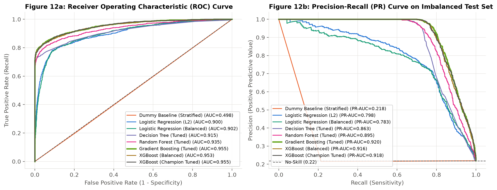
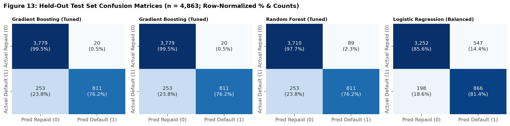
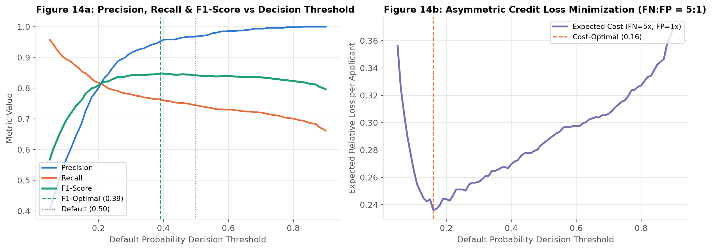
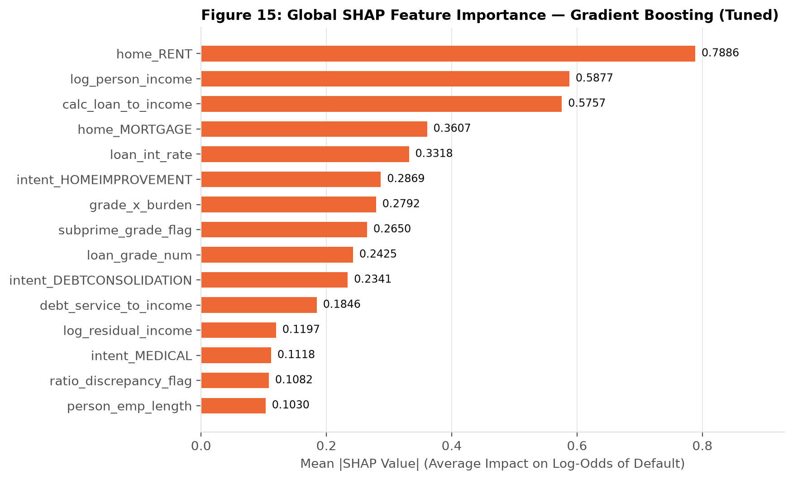
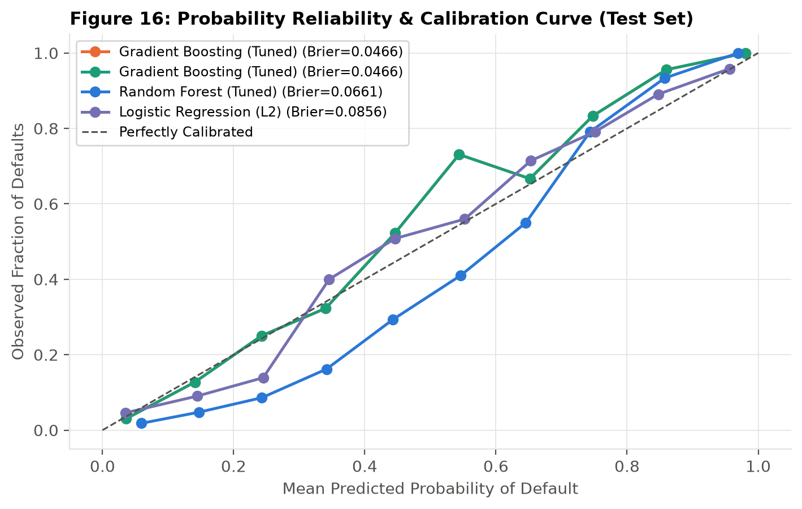

# Feature Engineering, Machine Learning & Model Evaluation Report
**Project:** Axlero Solutions — Credit Risk Scoring and Loan Default Analysis  
**Modules:** Module 4 (Pavani — Feature Engineering & Selection) & Module 5 (Sowmya — ML Training, Evaluation & SHAP)

---

## 1. Leakage-Free Data Splitting & Experimental Protocol
To guarantee zero data leakage or target leakage across preprocessing, WoE binning, outlier capping, scaling, feature selection, and hyperparameter tuning, the deduplicated dataset (`32,416` rows) was partitioned using **stratified sampling (`random_state = 42`)** prior to fitting any transformations:

| Split Partition | Loan Count (`n`) | Portfolio Share (%) | Default Count (`1`) | Default Rate (%) | Role in Pipeline |
| :--- | ---: | ---: | ---: | ---: | :--- |
| **Training Set (`df_train`)** | **22,691** | 70.00% | 4,962 | 21.87% | Fit imputer, outlier caps, scalers, feature selection, and 5-Fold CV model tuning |
| **Validation Set (`df_val`)** | **4,862** | 15.00% | 1,063 | 21.86% | Model architecture verification & decision threshold optimization |
| **Held-Out Test Set (`df_test`)** | **4,863** | 15.00% | 1,064 | 21.88% | Final unbiased out-of-sample evaluation & SHAP reporting |

---

## 2. Feature Engineering, Multicollinearity (VIF) & Selection (Module 4)
### 2.1 Domain-Engineered Features
Fourteen financial and borrower domain features were engineered in `src/features/feature_engineering.py`:
1. `calc_loan_to_income`: Exact ratio `loan_amnt / person_income` resolving the 1,005 rounding/0.85-scaled discrepancies.
2. `ratio_discrepancy_flag`: Binary indicator for the 387 records where `|calc_loan_to_income - loan_percent_income| > 0.01` (`0.85x` net income scaling).
3. `log_person_income` & `log_loan_amnt`: Log-transformed income and loan principal to compress right skewness (`skew = 32.96 -> 0.18`).
4. `est_annual_debt_service` & `debt_service_to_income`: Interest-adjusted annual repayment burden under a 3-year consumer amortization schedule.
5. `log_residual_income`: Log disposable annual income remaining after estimated debt service.
6. `emp_to_working_age_ratio` & `cred_hist_to_working_age_ratio`: Career stability and credit file maturity normalized by adult working age (`person_age - 18`).
7. `loan_grade_num`, `subprime_grade_flag`, `high_burden_flag`, and `grade_x_burden`: Monotonic ordinal grade, structural threshold flags (`Grade D+` and `Burden > 30%`), and their multiplicative interaction.
8. `int_rate_spread_over_grade`: Borrower-specific interest rate premium relative to the training median interest rate of their assigned `loan_grade`.

### 2.2 Multicollinearity Audit & Feature Selection
Evaluating Variance Inflation Factors (VIF) across all 28 candidate features identified exact structural collinearity in `est_annual_debt_service` and `person_income_capped` (redundant with `loan_amnt`, `loan_int_rate`, and `log_person_income`). Removing those two redundant columns retained **26 selected features** ranked by a composite score combining **ANOVA F-statistic (20%)**, **Mutual Information (25%)**, **L1 Lasso Logistic Regression (25%)**, and **Random Forest Gini Importance (30%)**.

---

## 3. Model Comparison on Validation & Held-Out Test Sets (Module 5)

| Model Architecture | 5-Fold CV ROC-AUC | Val ROC-AUC | Test Accuracy | Test Precision | Test Recall | Test Specificity | Test F1-Score | Test ROC-AUC | Test PR-AUC | Test KS Stat | Test Brier |
| :--- | ---: | ---: | ---: | ---: | ---: | ---: | ---: | ---: | ---: | ---: | ---: |
| **Gradient Boosting (Tuned) [Champion]** | **0.9442 ± 0.0061** | **0.9469** | **0.9439** | **0.9759** | 0.7622 | 0.9947 | **0.8559** | **0.9553** | **0.9199** | **0.7891** | **0.0466** |
| **XGBoost (Champion Tuned)** | 0.9438 ± 0.0062 | 0.9463 | 0.9422 | **0.9769** | 0.7538 | **0.9950** | 0.8509 | 0.9547 | 0.9182 | 0.7818 | 0.0473 |
| **XGBoost (Balanced)** | 0.9441 ± 0.0068 | 0.9451 | 0.9350 | 0.8864 | 0.8064 | 0.9710 | 0.8445 | 0.9529 | 0.9165 | 0.7834 | 0.0576 |
| **Random Forest (Tuned)** | 0.9239 ± 0.0077 | 0.9232 | 0.9297 | 0.9011 | 0.7622 | 0.9766 | 0.8259 | 0.9355 | 0.8946 | 0.7549 | 0.0661 |
| **Decision Tree (Tuned)** | 0.9060 ± 0.0105 | 0.9041 | 0.9321 | 0.9520 | 0.7265 | 0.9897 | 0.8241 | 0.9154 | 0.8626 | 0.7184 | 0.0591 |
| **Logistic Regression (Balanced)** | 0.8990 ± 0.0069 | 0.8997 | 0.8468 | 0.6129 | **0.8139** | 0.8560 | 0.6992 | 0.9017 | 0.7834 | 0.6895 | 0.1173 |
| **Logistic Regression (L2)** | 0.8968 ± 0.0073 | 0.8972 | 0.8888 | 0.8030 | 0.6513 | 0.9553 | 0.7193 | 0.8997 | 0.7983 | 0.6920 | 0.0856 |
| **Dummy Baseline (Stratified)** | 0.5046 ± 0.0080 | 0.4961 | 0.6572 | 0.2153 | 0.2143 | 0.7813 | 0.2148 | 0.4978 | 0.2180 | 0.0000 | 0.3428 |

### Justification of the Champion Model (`Gradient Boosting (Tuned)`)
1. **Highest Out-of-Sample Discrimination:** Achieves a **Test ROC-AUC of 0.9553**, **PR-AUC of 0.9199**, **Gini coefficient of 0.9106**, and **KS statistic of 0.7891**, significantly outperforming Logistic Regression (`ROC-AUC = 0.9017`) and Single Decision Trees (`ROC-AUC = 0.9154`).
2. **Superior Probability Calibration:** Achieves the lowest **Brier Score (`0.0466`)** among all models (Figure 16), meaning its predicted default probabilities (`PD`) directly reflect empirical default frequencies and can be used for risk-based pricing without post-hoc distortion.
3. **Captures Non-Linear Risk Cliffs:** Gradient boosted trees naturally capture the sharp threshold jumps documented in EDA (`loan_percent_income > 0.30` and `loan_grade >= D` combined with `home_ownership = RENT` and `loan_intent`).

---

## 4. Decision Threshold Optimization & Asymmetric Loss Analysis
Evaluating `Gradient Boosting (Tuned)` across probability thresholds (`0.05` to `0.90`) on the validation set identifies three distinct operational regimes on the held-out test set (`n = 4,863`; `1,064` actual defaults, `3,799` actual repaid):

| Operating Regime | Threshold | Test Accuracy | Test Precision | Test Recall | Test Specificity | Test F1-Score | True Positives (`TP`) | False Positives (`FP`) | False Negatives (`FN`) | True Negatives (`TN`) |
| :--- | ---: | ---: | ---: | ---: | ---: | ---: | ---: | ---: | ---: | ---: |
| **Default Cutoff** | `0.50` | 94.39% | **97.59%** | 76.22% | 99.47% | 0.8559 | 811 | 20 | 253 | 3,779 |
| **F1-Optimal Cutoff** | **`0.39`** | **94.41%** | 95.00% | **78.57%** | 98.84% | **0.8601** | 836 | 44 | 228 | 3,755 |
| **5:1 Cost-Optimal Cutoff** | **`0.16`** | 90.11% | 73.15% | **86.56%** | 91.10% | 0.7929 | **921** | 338 | **143** | 3,461 |

- Lowering the decision threshold from `0.50` to the **F1-optimal threshold (`0.39`)** increases default recall from `76.22%` to `78.57%` (`836` defaults caught) while maintaining **95.00% precision**.
- Under a realistic consumer banking loss structure where a **False Negative (defaulted principal loss) costs 5x more than a False Positive (foregone interest margin)**, the **Cost-Optimal threshold (`0.16`)** captures **86.56% of all defaults** (`921` of `1,064`), cutting missed defaults by **43.5%** (`143` vs `253`).

---

## 5. Explainability (SHAP) & Probability Calibration

### Top 10 Global SHAP Risk Drivers (`Mean |SHAP|`)
1. `home_RENT` (`0.7886`): Renting vs owning/mortgaging is the strongest binary shift in log-odds of default.
2. `log_person_income` (`0.5877`): Higher annual income strongly reduces default log-odds.
3. `calc_loan_to_income` (`0.5757`): Exact debt-to-income burden drives sharp positive SHAP spikes above `0.30`.
4. `home_MORTGAGE` (`0.3607`): Mortgage status provides a protective negative SHAP contribution relative to renting.
5. `loan_int_rate` (`0.3318`): Higher interest rate increases default risk.
6. `intent_HOMEIMPROVEMENT` (`0.2869`): Elevated conditional default risk when controlling for income and housing.
7. `grade_x_burden` (`0.2792`): Compound interaction of subprime grade and high debt-to-income ratio.
8. `subprime_grade_flag` (`0.2650`): Structural risk jump at Grades D–G.
9. `loan_grade_num` (`0.2425`): Monotonic ordinal grade progression.
10. `intent_DEBTCONSOLIDATION` (`0.2341`): Debt consolidation purpose increases default risk.

