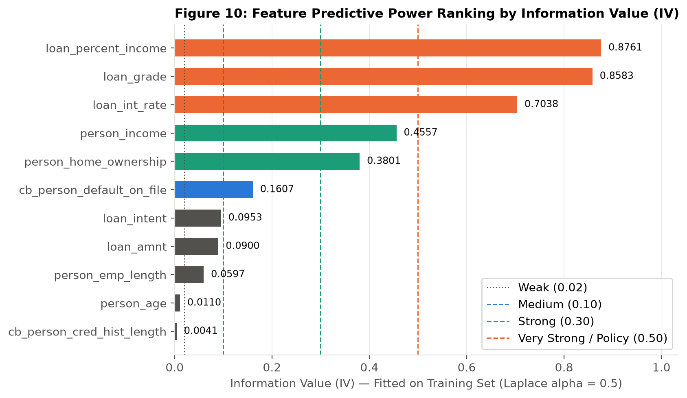
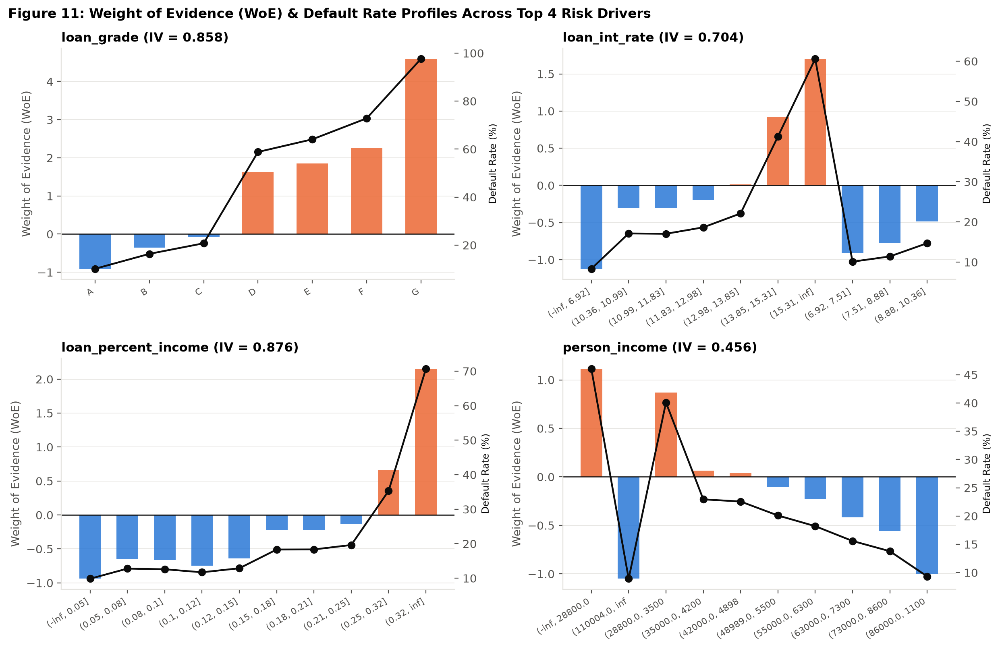

# Statistical Analysis & Weight of Evidence (WoE) / Information Value (IV) Report
**Project:** Axlero Solutions — Credit Risk Scoring and Loan Default Analysis  
**Module:** Module 3 (Charukesh — Implemented & Validated from Scratch)

---

## 1. Parametric & Non-Parametric Hypothesis Tests on Numerical Features
Because financial features such as `person_income` (skewness = `32.96`, kurtosis = `2,700.70`) depart sharply from normality, we evaluate both **Welch's two-sample t-test** and non-parametric **Mann-Whitney U** and **Two-Sample Kolmogorov-Smirnov (KS)** tests across `n = 32,416` validated records (`25,327` repaid vs `7,089` defaulted):

| Feature | Repaid Median (Mean) | Default Median (Mean) | Welch $t$-Stat ($p$-val) | Mann-Whitney $U$ ($p$-val) | Rank-Biserial $r_{rb}$ | KS Stat $D_{KS}$ | Spearman $r_s$ |
| :--- | ---: | ---: | ---: | ---: | ---: | ---: | ---: |
| `loan_percent_income` | 0.14 (0.149) | 0.25 (0.247) | 56.60 ($<10^{-300}$) | $1.29 \times 10^8$ ($<10^{-300}$) | **+0.4419** | **0.3519** | +0.3165 |
| `loan_int_rate` | 10.65% (10.45%) | 13.48% (13.05%) | 60.28 ($<10^{-300}$) | $1.30 \times 10^8$ ($<10^{-300}$) | **+0.4448** | **0.3340** | +0.3185 |
| `person_income` | \$60,000 (\$70,849) | \$41,682 (\$49,094) | -36.16 ($6.0 \times 10^{-278}$) | $5.56 \times 10^7$ ($<10^{-300}$) | **-0.3802** | **0.2802** | -0.2722 |
| `loan_amnt` | \$8,000 (\$9,240) | \$9,600 (\$10,857) | 17.41 ($6.9 \times 10^{-67}$) | $1.00 \times 10^8$ ($3.2 \times 10^{-52}$) | +0.1179 | 0.1172 | +0.0845 |
| `person_emp_length` | 4.0 yrs (4.94) | 3.0 yrs (4.11) | -16.06 ($2.1 \times 10^{-57}$) | $7.78 \times 10^7$ ($3.6 \times 10^{-67}$) | -0.1337 | 0.1047 | -0.0962 |
| `person_age` | 26.0 yrs (27.80) | 26.0 yrs (27.47) | -3.90 ($9.8 \times 10^{-5}$) | $8.55 \times 10^7$ ($4.9 \times 10^{-10}$) | -0.0481 | 0.0355 | -0.0346 |
| `cb_person_cred_hist_length` | 4.0 yrs (5.85) | 4.0 yrs (5.68) | -2.95 ($3.2 \times 10^{-3}$) | $8.67 \times 10^7$ ($7.0 \times 10^{-6}$) | -0.0345 | 0.0307 | -0.0250 |

**Key Statistical Insight:** While `person_age` and `cb_person_cred_hist_length` achieve $p < 0.01$ due to the large sample size ($n = 32,416$), their non-parametric effect sizes ($r_{rb} = -0.048$ and $-0.035$, KS $\approx 0.03$) confirm negligible standalone discriminatory power. Conversely, `loan_percent_income` ($D_{KS} = 0.3519$), `loan_int_rate` ($D_{KS} = 0.3340$), and `person_income` ($D_{KS} = 0.2802$) exhibit large, practically meaningful distributional separation.

---

## 2. Categorical Variables: Chi-Square ($\chi^2$), Cramér's V & Odds Ratios

| Categorical Feature | Categories ($k$) | $\chi^2$ Statistic | Degrees of Freedom | $p$-Value | Cramér's $V$ | Effect Strength |
| :--- | ---: | ---: | ---: | ---: | ---: | :--- |
| `loan_grade` | 7 | 5,588.33 | 6 | $< 10^{-300}$ | **0.4152** | **Strong ($> 0.30$)** |
| `person_home_ownership` | 4 | 1,894.35 | 3 | $< 10^{-300}$ | **0.2417** | **Moderate ($0.15 - 0.30$)** |
| `cb_person_default_on_file` | 2 | 1,041.97 | 1 | $1.35 \times 10^{-228}$ | **0.1793** | **Moderate ($0.15 - 0.30$)** |
| `loan_intent` | 6 | 520.18 | 5 | $3.51 \times 10^{-110}$ | **0.1267** | **Weak ($< 0.15$)** |

### Category-Level Default Rates, 95% Wilson Confidence Intervals & Odds Ratios
- **Loan Grade (Reference = `A`, Default Rate = `9.96%` [95% CI: `9.41% – 10.54%`]):**
  - `B`: `16.26%` [CI: `15.56% – 16.98%`], Odds Ratio = **1.75x**
  - `C`: `20.75%` [CI: `19.78% – 21.76%`], Odds Ratio = **2.37x**
  - `D`: `59.06%` [CI: `57.45% – 60.65%`], Odds Ratio = **13.04x**
  - `E`: `64.38%` [CI: `61.31% – 67.34%`], Odds Ratio = **16.33x**
  - `F`: `70.54%` [CI: `64.50% – 75.94%`], Odds Ratio = **21.58x**
  - `G`: `98.44%` [CI: `91.67% – 99.72%`], Odds Ratio = **383.85x** (smoothed for $n=64$)
- **Home Ownership (Reference = `OWN`, Default Rate = `7.53%` [95% CI: `6.57% – 8.62%`]):**
  - `MORTGAGE`: `12.62%` [CI: `12.07% – 13.19%`], Odds Ratio = **1.77x**
  - `OTHER`: `31.13%` [CI: `23.11% – 40.48%`], Odds Ratio = **5.57x**
  - `RENT`: `31.61%` [CI: `30.90% – 32.33%`], Odds Ratio = **5.67x**
- **Prior Default on File (Reference = `N`, Default Rate = `18.43%` [95% CI: `17.97% – 18.90%`]):**
  - `Y`: `37.91%` [CI: `36.66% – 39.17%`], Odds Ratio = **2.70x**

---

## 3. Weight of Evidence (WoE) & Information Value (IV) Analysis

### 3.1 Mathematical Formulation & Leakage Prevention
All quantile bin edges (`q = 10` deciles for continuous variables) and category frequencies are computed **strictly on the stratified training split (`n = 22,691`)** so that validation and test sets never leak into WoE/IV calculations. Zero-event or zero-non-event bins are regularized using **Laplace smoothing ($\alpha = 0.5$)**:

$$\text{Dist}_{\text{Event}, i} = \frac{E_i + 0.5}{\sum_{j=1}^{k} (E_j + 0.5)}, \qquad \text{Dist}_{\text{NonEvent}, i} = \frac{NE_i + 0.5}{\sum_{j=1}^{k} (NE_j + 0.5)}$$

$$\text{WoE}_i = \ln\!\left(\frac{\text{Dist}_{\text{Event}, i}}{\text{Dist}_{\text{NonEvent}, i}}\right), \qquad \text{IV} = \sum_{i=1}^{k} \left(\text{Dist}_{\text{Event}, i} - \text{Dist}_{\text{NonEvent}, i}\right) \cdot \text{WoE}_i$$

### 3.2 Information Value (IV) Feature Ranking & Interpretation

| Rank | Feature | Variable Type | Bins | Information Value (IV) | Siddiqi (2006) Predictive Power Classification | Analytical Interpretation & Limitations |
| ---: | :--- | :--- | ---: | ---: | :--- | :--- |
| 1 | `loan_percent_income` | Numeric | 10 | **0.8761** | Very Strong (`> 0.50`) | Primary affordability ratio; jumps sharply to WoE = `+1.84` in the top decile (`> 0.31`). |
| 2 | `loan_grade` | Categorical | 7 | **0.8583** | Very Strong / Policy (`> 0.50`) | Lender-assigned underwriting grade; reflects composite bureau & pricing policy. |
| 3 | `loan_int_rate` | Numeric | 10 | **0.7038** | Very Strong / Policy (`> 0.50`) | Strongly collinear with `loan_grade`; pricing risk premium set by lender. |
| 4 | `person_income` | Numeric | 10 | **0.4557** | Strong Predictor (`0.30 – 0.50`) | Monotonically decreasing WoE from `+0.98` (lowest decile `<= $28.8k`) to `-1.36` (`> $110k`). |
| 5 | `person_home_ownership` | Categorical | 4 | **0.3801** | Strong Predictor (`0.30 – 0.50`) | Strong separation between `OWN` (WoE = `-1.19`), `MORTGAGE` (`-0.63`), and `RENT` (`+0.51`). |
| 6 | `cb_person_default_on_file` | Categorical | 2 | **0.1607** | Medium Predictor (`0.10 – 0.30`) | Historical delinquency (`Y`: WoE = `+0.79`, `N`: WoE = `-0.20`). |
| 7 | `loan_intent` | Categorical | 6 | **0.0953** | Weak Predictor (`0.02 – 0.10`) | Useful secondary signal (`DEBTCONSOLIDATION` WoE = `+0.39` vs `VENTURE` WoE = `-0.47`). |
| 8 | `loan_amnt` | Numeric | 10 | **0.0900** | Weak Predictor (`0.02 – 0.10`) | Non-linear alone; informative mainly when normalized by income. |
| 9 | `person_emp_length` | Numeric | 9 | **0.0597** | Weak Predictor (`0.02 – 0.10`) | Early career (`0–1 yrs` WoE = `+0.33`) carries elevated default risk. |
| 10 | `person_age` | Numeric | 10 | **0.0110** | Not Predictive (`< 0.02`) | Near-zero standalone separation across age deciles. |
| 11 | `cb_person_cred_hist_length` | Numeric | 7 | **0.0041** | Not Predictive (`< 0.02`) | Negligible standalone IV; collinear with `person_age` ($r_s = 0.81$). |

